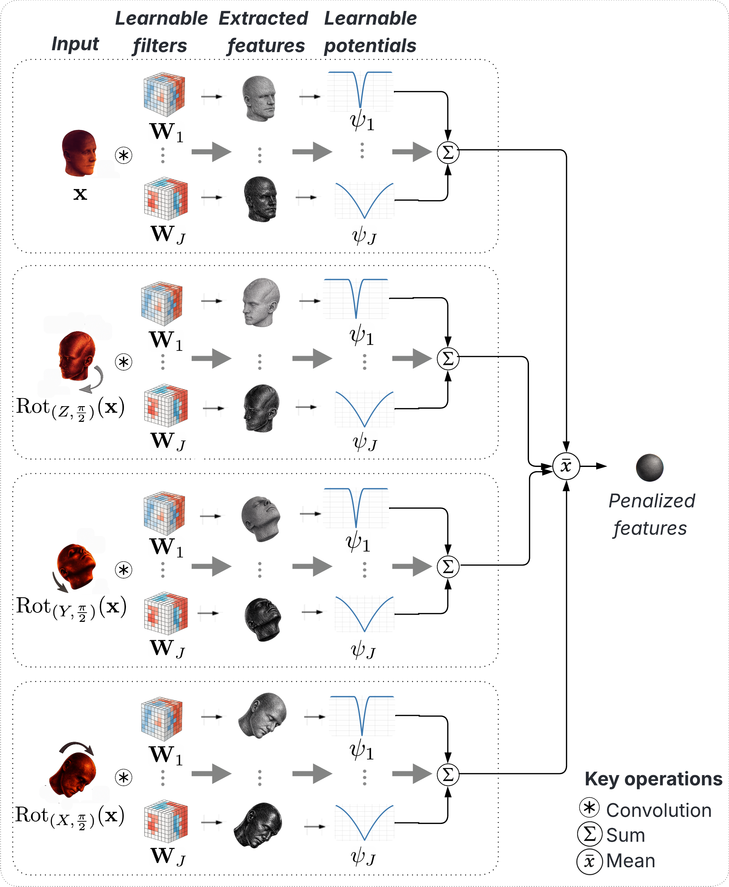
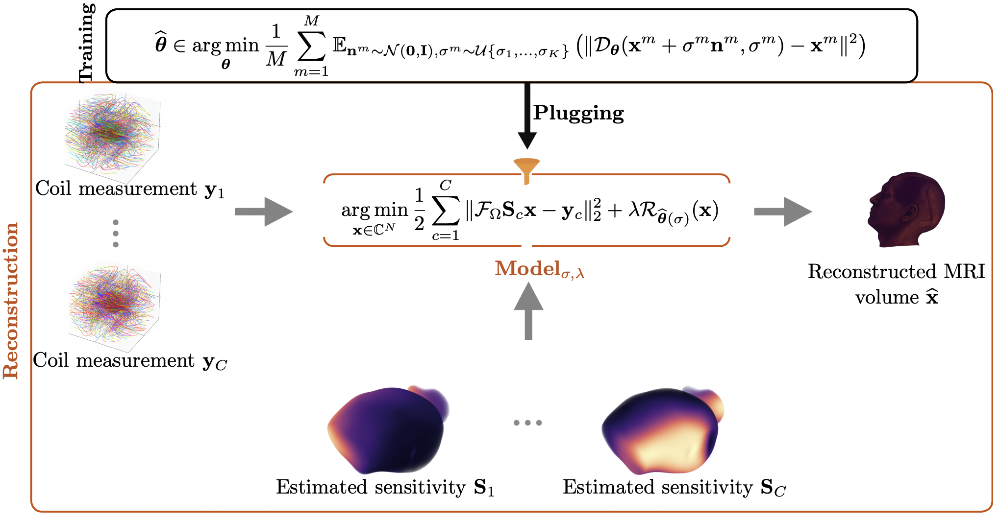

# Weakly Convex Ridge Regularization for 3D Non-Cartesian MRI Reconstruction

[](https://doi.org/10.1002/mrm.70632)
[](https://arxiv.org/abs/2603.27158)

This repository contains the official PyTorch implementation of **WCRR (Weakly Convex Ridge Regularizer)**, a rotation-invariant regularizer integrated into a variational framework for accelerated 3D non-Cartesian MRI reconstruction.

📄 **Paper:** [Magnetic Resonance in Medicine](https://doi.org/10.1002/mrm.70632) | [arXiv](https://arxiv.org/abs/2603.27158)

<table align="center">
  <tr>
    <td align="center">
      <br>
      <b>(a) Regularizer Architecture</b>
    </td>
    <td align="center">
      <br>
      <b>(b) Training and Reconstruction Pipeline</b>
    </td>
  </tr>
</table>

https://github.com/user-attachments/assets/1801b5bb-19c1-40ff-8ea1-f67f260beff6

---

## 🔧 Setup

### 1. Installation and preliminaries

Clone the repository:

```bash
git clone https://github.com/Shamachrist7/wcrr-noncartesian-3d-mri.git
cd wcrr-noncartesian-3d-mri
```

#### a. Installation (Conda)

Install the dependencies using [`environment.yaml`](environment.yaml).

```bash
conda env create -f environment.yaml
conda activate wcrr_env
```

Note that at least a CUDA 12 machine is necessary. Previous versions might encounter some issues.

Before running scripts, you may set the following environment variables to reduce TensorFlow-related logging:

```bash
export TF_ENABLE_ONEDNN_OPTS=0
export TF_CPP_MIN_LOG_LEVEL=3
```

#### b. Preliminaries
Before runing anything, sign up to Weights & Biases (If you don't have an account yet) through [wandb.ai/authorize](http://wandb.ai/signup). Once logged in into your account, go to *Settings → API keys*, then copy your **wandb API Key**. Finally in your Terminal (environment in which you are going to run everything), run ```wandb login```. You will be asked to provide your API Key; Paste it in there and validate. Your **wandb** automatic monitor of all the runs is all set.


### 2. Data Processing
The Calgary Campinas Train & Val data consist of 67 fully-sampled 12-coil k-space volumes saved as **.h5** files. First of all, organize them in a root directory that we will call **my_root_directory**, containing two folders named exactly **Train** (which contains the 47 .h5 training k-space volumes) and **Val** (which contains the 20 .h5 validation k-space volumes). For training purposes, we need the True image volumes (that we can compute by performing a 3D virtual coil combination (vcc) of the image domain versions of those kspaces). To get them, just run:
```
python data_processing/preprocess_calgary.py --root my_root_directory
```
It will create in each of the folders **Train** and **Val**, two sub-folders named **_images** (which contains the 12-coil image domain versions as .npy files; Each file actually keeps the name of its kspace version but ends with .h5.npy) and **_images_vcc** (which contains the estimated True MR image volumes via 3D virtual coil combination, as .npy files; Each file actually keeps the name of its kspace version but ends with .npy).


The Calgary Campinas Test data consist of 50 fully-sampled 12-coil k-space volumes and 50 fully-sampled 32-coil k-space volumes as **.h5** files. They just have to be organized as follows. In **my_root_directory**, create a folder named **Test** in which we have two sub-folders named **12coil** (which contains the  50 12-coil k-space .h5 files) and **32coil** (which contains the  50 32-coil k-space .h5 files). No further preprocessing of the Test data is required!


### 3. Baseline reconstruction methods and pretrained weights
On the retrospectively simulated accelerated acquisitions, we compare *WCRR* to the following MRI reconstruction methods:
- GRAPPA + DCp (Density Compensation)
- Isotropic TV (Total Variation) solved with PDHG (Primal Dual Hybrid Gradient)
- $l_1$-wavelet solved with FISTA
- Plug-and-Play: DPIR coupled with a 3D DRUNet denoiser
- NC-PDNet unrolled network
- DRUNet3D post-processing
- Score-DiffMBIR

The following checkpoint locations are expected by [`reconstructions.py`](reconstructions.py):

| Method | `--method` | Expected checkpoint |
|---|---|---|
| WCRR | `wcrr` | `weights/bilevel_Denoising/WCRR_16_bilevel_IFT_ckpt_500.pt` (included in the repository) |
| DPIR / 3D DRUNet | `drunet` | `weights/drunet/drunet_3d_complex_denoise.pth` ([download pretrained model](https://huggingface.co/deepinv/drunet_3d_denoise_complex/tree/main)) |
| NC-PDNet | `ncpdnet` | `weights/ncpdnet/NCPDNetWeights47.pth` ([download checkpoint](https://tuc.cloud/index.php/s/BbgR3KTKmQqpEiQ)) |
| DRUNet3D (post-processing) | `postprocess` | `weights/PostProcess/ckp_epoch_500.pt` ([download](https://tuc.cloud/index.php/s/aMHznrXyPMFJBBp)) |
| Score-DiffMBIR | `score-diff` | `weights/NCSNpp2D/ckpt_0035000.pt` ([download checkpoint](https://tuc.cloud/index.php/s/cYAksFSgw44c8Wa)) |

In case you wish to retrain WCRR (And thus reproduce its weights by yourself), just run: ```python training_wcrr.py --root my_root_directory```


### 4. Hyperparameter tuning (In case you wish to reproduce the hyperparameter choices for each method)
Five specific validation volumes are chosen, and all the hyperparameters for each reconstruction method are tuned on them. *GRAPPA*'s parameters are already appropriately chosen and do not require tuning. *NC-PDNet's* Neither. We can tune the hyperparameters of each of the other methods by runing the following commands:
- For WCRR: ```python hyperparameters_tuning/tune_wcrr.py --root my_root_directory```
- For DPIR: ```python hyperparameters_tuning/tune_pnp_drunet.py --root my_root_directory```
- For TV: ```python hyperparameters_tuning/tune_tv.py --root my_root_directory```
- For $l1$-wavelet: ```python hyperparameters_tuning/tune_l1_wavelets.py --root my_root_directory```

### 5. Reconstructions (This reproduces the results on the retrospectively simulated acquisitions in the paper!)
The reconstructions with each method are performed on 30 testing volumes (among which the first 15 12-coil volumes and the first 15 32-coil volumes according to the alphabetical order of the volume file names) by running the following commands for coil = 12 and then for coil = 32:
- Preliminarily to precompute the coil sensitivity maps for memory efficiency: ```python reconstructions.py --smaps_precomputation True --coil coil --root my_root_directory```
- Reconstructions with WCRR: ```python reconstructions.py --method "wcrr" --coil coil --root my_root_directory```
- Reconstructions with NC-PDNet: ```python reconstructions.py --method "ncpdnet" --coil coil --root my_root_directory```
- Reconstructions with DPIR: ```python reconstructions.py --method "drunet" --coil coil --root my_root_directory```
- Reconstructions with TV: ```python reconstructions.py --method "tv" --coil coil --root my_root_directory```
- Reconstructions with $l_1$-wavelet: ```python reconstructions.py --method "wv" --coil coil --root my_root_directory```
- Reconstructions with DRUNet3D: ```python reconstructions.py --method "postprocess" --coil coil --root my_root_directory```
- Reconstructions with Score-DiffMBIR: ```python reconstructions.py --method "score-diff" --coil coil --root my_root_directory```
- GRAPPA reconstructions are automatically performed whenever one of the above reconstructions is launched (except for DRUNet3D), and the results are saved with wandb.

### 6. Results and examples

- [`reconstruction_results.ipynb`](reconstruction_results.ipynb): fetch reconstruction metrics from Weights & Biases and visualize saved reconstructions.
- [`reconstruction_example.ipynb`](reconstruction_example.ipynb): reconstruct a single MRI volume with WCRR.
- [`prospective.ipynb`](prospective.ipynb): examples for prospective acquisitions.

---

## ✉️ Questions?

For questions or feedback, contact [shamachrist7@gmail.com](mailto:shamachrist7@gmail.com).

## 📄 License

This project is released under the MIT License.

## 📫 Citation

If you use this code, please cite:

```bibtex
@article{wache2026weaklyconvex,
  title   = {Weakly Convex Ridge Regularization for 3D Non-Cartesian MRI Reconstruction},
  author  = {Wache, German Shâma and G R, Chaithya and Tanabene, Asma and Neumayer, Sebastian},
  journal = {Magnetic Resonance in Medicine},
  year    = {2026},
  doi     = {10.1002/mrm.70632},
  url     = {https://doi.org/10.1002/mrm.70632}
}
```


